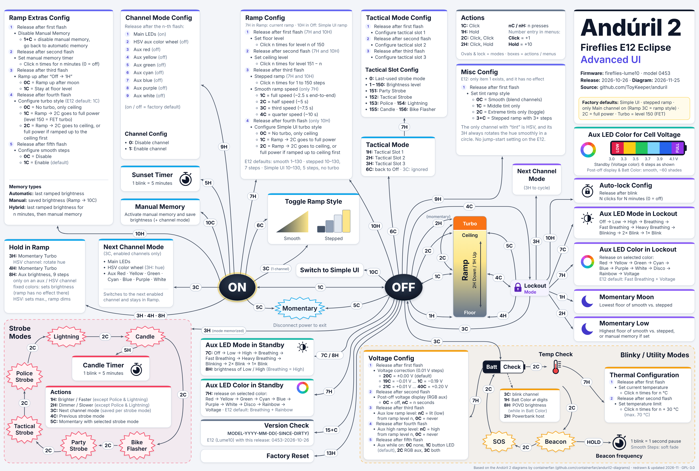
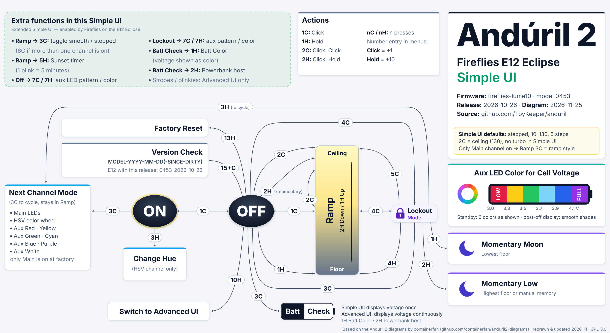

# Andúril 2 UI diagrams

Redrawn and updated button-mapping diagrams for the
[Andúril 2](https://github.com/ToyKeeper/anduril) flashlight firmware.
They keep the layout of the well-known 2023 diagrams, with a modern look.
They were checked against **firmware release 2026-10-26** and corrected where
the old diagrams were wrong or missing features (new aux LED patterns and
brightness, Batt Color, Powerbank host, voltage config items 3–5, Extended
Simple UI, …).

Two variants are generated from the same source:

| Variant | Advanced UI | Simple UI |
|---|---|---|
| **Fireflies E12 Eclipse** (`fireflies-lume10`, model 0453): real channel list, factory defaults, no multi-channel features it doesn't have | [PNG](diagrams/anduril2-e12-advanced-ui.png) · [SVG](diagrams/anduril2-e12-advanced-ui.svg) | [PNG](diagrams/anduril2-e12-simple-ui.png) · [SVG](diagrams/anduril2-e12-simple-ui.svg) |
| **Generic multi-channel**, like the original (★ = only on some lights) | [PNG](diagrams/anduril2-generic-advanced-ui.png) · [SVG](diagrams/anduril2-generic-advanced-ui.svg) | [PNG](diagrams/anduril2-generic-simple-ui.png) · [SVG](diagrams/anduril2-generic-simple-ui.svg) |





The detailed comparison of the old diagrams with the firmware (in German) is in
[docs/firmware-review.de.md](docs/firmware-review.de.md).

## Building

The diagrams are generated as SVG by Python scripts and rendered to PNG with
headless Chromium.

Requirements: Python 3 with Pillow, Node.js 18+, `make` and the
[Inter](https://rsms.me/inter/) font (`apt install fonts-inter` on
Debian/Ubuntu; set `INTER_FONT_DIR` if it lives elsewhere).

```bash
pip install -r requirements.txt
npm ci
npx playwright install chromium
make          # regenerate everything in diagrams/
make check    # geometric layout check
```

| Path | Purpose |
|---|---|
| `src/common.py` | Drawing helpers: cards, arrows, label pills (snapped onto their arrow), icons |
| `src/advanced.py`, `src/simple.py` | The two diagrams; `python3 src/advanced.py OUT.svg e12\|generic` |
| `tools/render.js` | SVG → PNG |
| `tools/check.js` | Layout check: overlapping text, labels off or under foreign arrows, arrows through cards / text, crossings, near-parallel arrows, text overflow |
| `tools/layout-allowlist.txt` | Findings that were reviewed and accepted |

## CI

On every push and pull request, GitHub Actions rebuilds all diagrams on
Ubuntu 24.04 and runs the layout check. The build fails on any finding that
isn't in the allowlist. On `main`, regenerated SVG/PNG files are committed back
automatically, so the committed images always match the source. Every run also
uploads the diagrams as a build artifact.

## Credits

- Layout and much of the wording are based on the
  [Andúril 2 UI diagrams by containerfan](https://github.com/containerfan/anduril2-diagrams)
  (GPL-3.0, revision 2023-10-03), which were in turn inspired by
  [Lux-Perpetua's diagram on BLF](https://budgetlightforum.com/node/76941).
  This project redraws them from scratch with a new look, and corrects and
  extends the content for current firmware.
- Firmware and documentation: [Andúril](https://github.com/ToyKeeper/anduril) by Selene ToyKeeper (GPL-3.0).
- Font: [Inter](https://rsms.me/inter/) by Rasmus Andersson (SIL Open Font License); not included here.

## License

GPL-3.0, the same as the diagrams this work is based on. See [LICENSE](LICENSE).
